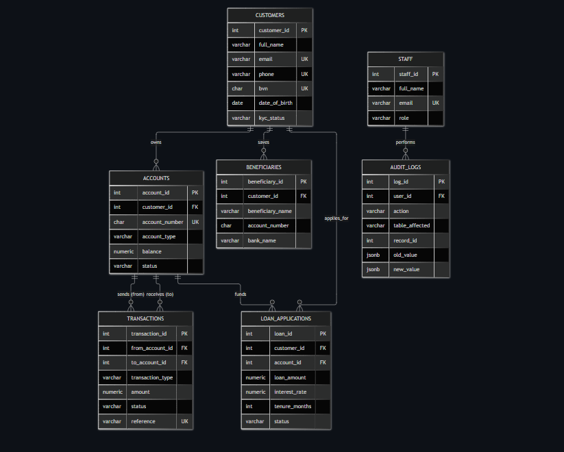
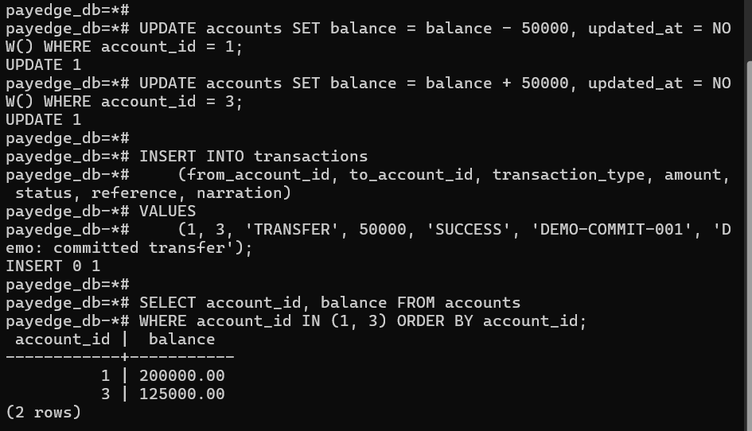
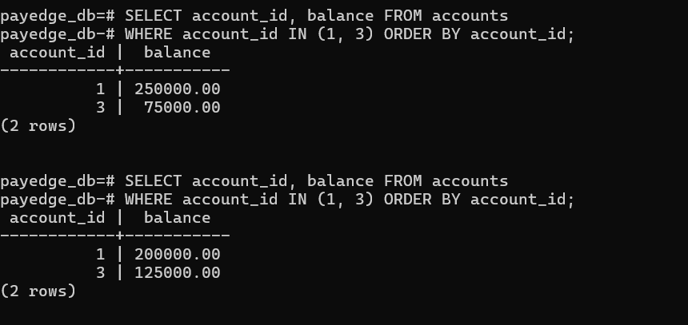
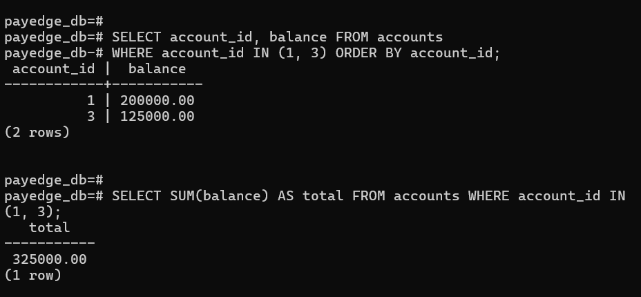
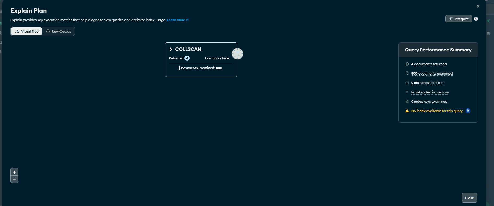
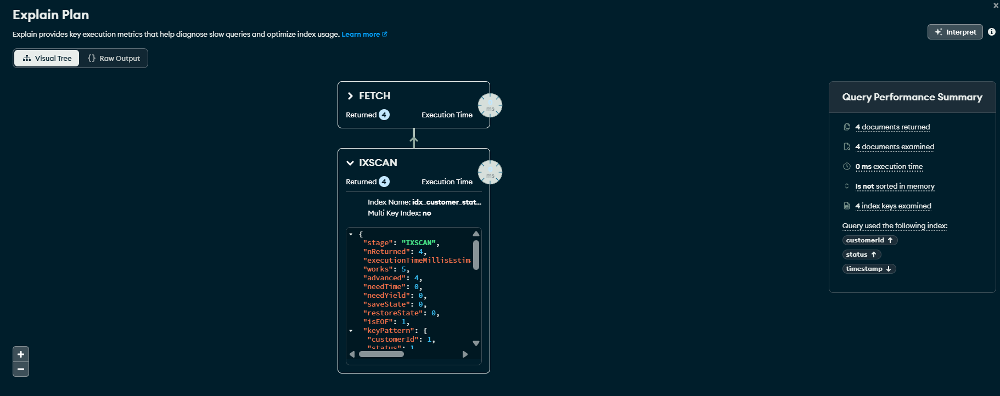
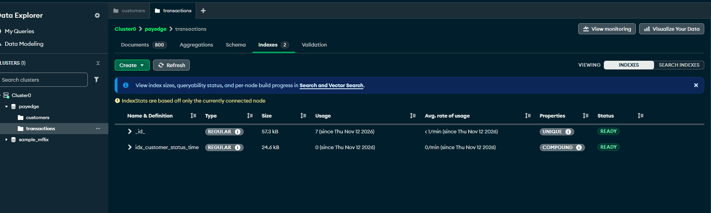
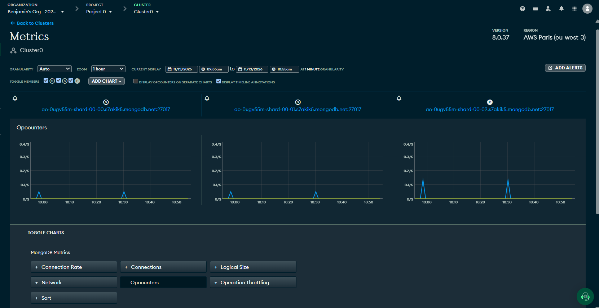
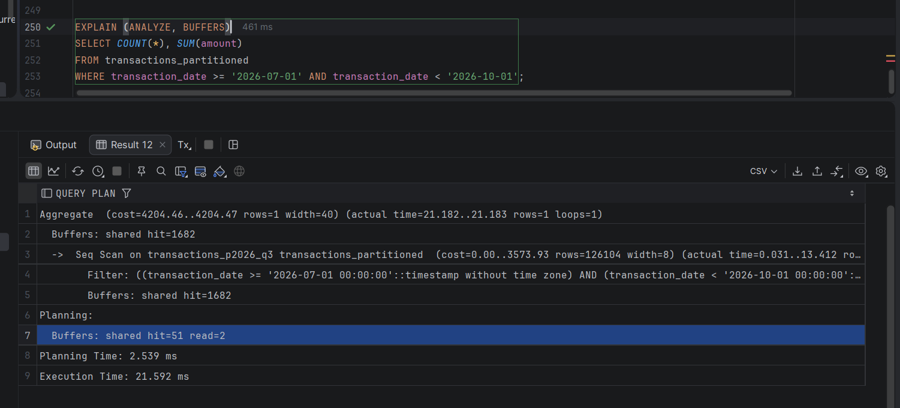

# PayEdge Database Management Portfolio

GitHub Repository: https://github.com/Bemmanuel01/payedge-database-portfolio.git


## Overview:
This PAYEDGE repository contains practical projects and implementations covering key concepts in Database Management Systems (DBMS). It demonstrates my understanding of database design, query optimisation, transaction management, NoSQL databases, and distributed database systems.

## Objective:
To demonstrate practical database management skills through hands-on projects, technical implementations, and real-world use cases.

## Portfolio Structure:

### 1. Database Design and Modelling
Covers database design principles, entity-relationship modelling, normalisation and relational database implementation.

### 2. Query Processing and Optimisation
Explores SQL queries, indexing, query execution plans, and optimisation techniques for improving database performance.

### 3. Transactions and Concurrency
Demonstrates transaction management, ACID properties, concurrency control, locking mechanisms, and database recovery.

### 4. NoSQL and Advanced Data Models
Explores NoSQL databases, document stores, key-value databases, graph databases, and advanced data modelling techniques.

### 5. Distributed and Cloud Databases
Covers distributed database architecture, fragmentation, replication, cloud database platforms, scalability, and fault tolerance.

## Technologies & Languages:
- SQL
- PostgreSQL
- MongoDB
- IntelliJ
- Java (21)
- Git & GitHub

---

## Case Study Declaration - PayEdge Digital Bank

| Item | Description |
|---|---|
| Organisation | PayEdge Digital Bank, a simulated digital-first retail bank in Nigeria |
| Nature of the system | Account management, transfers, deposits and withdrawals, loans and auditing |
| Users of the database | Customers, tellers, loan officers, administrators and compliance officers |
| Major data stored | Customers and KYC details, accounts and balances, transactions, beneficiaries, loan applications, staff, audit logs |
| Key operations | Open an account, transfer funds, deposit and withdraw, reverse a failed transaction, apply for a loan, audit changes |

All five portfolios use the **PayEdge Digital Bank Database Management System**.

---

## Portfolio Index

| Portfolio | Folder | What it demonstrates | Headline result |
|---|---|---|---|
| 1. Database design and modelling | [`portfolio-1-database-design`](portfolio-1-database-design/) | ER model, keys and constraints, normalisation | Seven related PostgreSQL tables in third normal form, with documented exceptions |
| 2. Query processing and optimisation | [`portfolio-2-query-optimisation`](portfolio-2-query-optimisation/) | Queries, execution plans, indexing | Execution time fell from 113.7 ms to 1.8 ms, 140.2 ms to 4.1 ms and 503.8 ms to 0.4 ms. The indexes cost about 22 MB |
| 3. Transactions and concurrency | [`portfolio-3-transactions-concurrency`](portfolio-3-transactions-concurrency/) | Commit, rollback, savepoints, lost update, locking, isolation levels | A lost update gave 1,300,000 instead of 1,200,000, and row locking prevented it |
| 4. NoSQL and advanced data models | [`portfolio-4-nosql`](portfolio-4-nosql/) | MongoDB document model, aggregation, indexing, graph discussion | Explain plan went from a collection scan of 800 documents to an index scan of 4 |
| 5. Distributed and cloud database exercise | [`portfolio-5-distributed-cloud`](portfolio-5-distributed-cloud/) | Replication, shard-key analysis, partitioning, CAP trade-offs | A one-quarter query read 1,682 pages instead of 6,667 from a partitioned table |

Each folder has its own `README.md` that explains how the work was done and tested, lists the evidence, and ends with a short reflection.

---
## Supporting Figures

A selection of the evidence from each portfolio. The full set of screenshots, with explanations, is in each portfolio's own `screenshots/` folder and `README.md`.

### Figure 1: ER diagram of the PayEdge database (Portfolio 1)



*The seven related tables (customers, accounts, transactions, beneficiaries, loan_applications, staff and audit_logs) and the foreign keys between them.*

### Figure 2: EXPLAIN ANALYZE before and after indexing (Portfolio 2)

| Query A before indexing | Query A after indexing |
|---|---|
|  |  |

*Lookup of one account's transactions. Before: a parallel sequential scan of the whole table, 113.7 ms. After: a bitmap scan using `idx_txn_from_account`, 1.8 ms.*

### Figure 3: Two-terminal isolation demonstration (Portfolio 3)

| Terminal A before commit | Terminal B isolated | Terminal B after commit |
|---|---|---|
|  |  |  |

*Terminal A holds an open transfer. Terminal B still sees the old balances (250,000 and 75,000) until A commits, and afterwards sees 200,000 and 125,000 with the combined total unchanged at 325,000.*

### Figure 4: Atlas Explain plan, collection scan against index scan (Portfolio 4)

| Explain plan before | Explain plan after | Index after |
|---|---|---|
|  |  |  |

*Before: a collection scan examined 800 documents to return 4. After: an index scan examined 4. The compound index `idx_customer_status_time` is 24.6 kB.*

### Figure 5: Replica set members and partition pruning (Portfolio 5)

| Replica set members | Partition pruning |
|---|---|
|  |  |

*Left: the Atlas cluster in AWS Paris, with one primary and two secondaries. Right: a query for one quarter scanned only the `transactions_p2026_q3` partition.*

---

## Repository Structure

```
payedge-database-portfolio/
├── portfolio-1-database-design/
├── portfolio-2-query-optimisation/
├── portfolio-3-transactions-concurrency/
├── portfolio-4-nosql/
├── portfolio-5-distributed-cloud/
├── Benjamin_Emmanuel_PAYEDGE_PORTFOLIO_DOCUMENTATION
└── Benjamin_Emmanuel_README.md
```

## Tools

| Tool | Used for |
|---|---|
| PostgreSQL 17 and pgAdmin 4 | Relational design, optimisation, transactions, partitioning |
| `psql` (two terminal sessions) | Concurrency and isolation demonstrations |
| IntelliJ IDEA (Database Tools) | Writing and running SQL, ER diagram, execution plans |
| MongoDB Atlas (free M0 cluster) | Document model, aggregation, Explain, replica set |
| Java 21 | Generating the 800 transaction documents for MongoDB |
| Git and GitHub | Version control, with commits made progressively as the work was done |

---

## Portfolio Processes:

**PostgreSQL**

1. Create the database: `CREATE DATABASE payedge_db;`
2. Portfolio 1: run `schema.sql`, then `data.sql`.
3. Portfolio 2: run `seed_volume.sql` **once only**, then follow the steps in that folder's README (baseline plans, then `indexes.sql`, then the same plans again).
4. Portfolio 3: the demonstrations need two live `psql` sessions, so follow that folder's README. `reset_demo.sql` restores the sample balances.
5. Portfolio 5: run `partitioning.sql` after the earlier steps.

**MongoDB Atlas**

1. Create a free cluster and a database named `payedge`.
2. Portfolio 4: insert `customers.json`, run `java Transactions.java` to produce `transactions.json`, and import it into the `transactions` collection.

---

## Security

No passwords, connection strings or keys are stored in this repository. Atlas credentials were kept outside the project, and screenshots show no passwords. IP addresses in the Atlas screenshots are blurred.

---

## AI Use Declaration

- **Tool used:** Claude (Anthropic).
- **Used for:** explaining concepts, drafting initial SQL, MongoDB and Java examples, and structuring the documentation.
- **How the output was reviewed and verified:** I ran every statement myself in PostgreSQL 17 and MongoDB Atlas, corrected errors as they occurred, and took all results, timings and screenshots from my own runs.

---
## Author
Emmanuel Benjamin 
(Student ID: 301889514)
