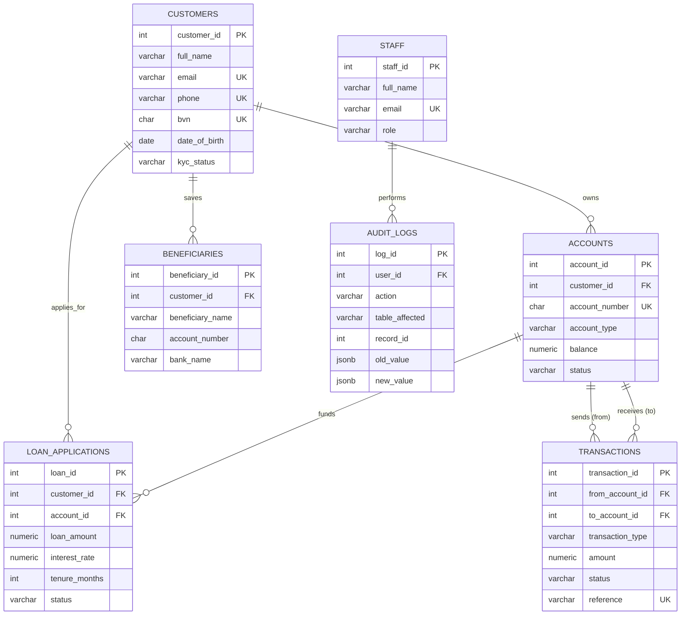

# Portfolio 1: Database Design and Modelling

- **Course:** MIT 8103 Advanced Database Systems, MIVA Open University
- **Case study:** PayEdge Digital Bank (digital retail banking platform, Nigeria)
- **DBMS and tools:** PostgreSQL 17, pgAdmin 4, IntelliJ IDEA (Database Tools), Git and GitHub

---

## 1. Case Study Declaration

| Item | Description |
|---|---|
| Organisation | PayEdge Digital Bank, a digital-first retail bank serving individual customers in Nigeria |
| Nature of the system | Account management, fund transfers, deposits and withdrawals, loan applications, and auditing |
| Users of the database | Customers, tellers, loan officers, administrators, and compliance officers |
| Major data stored | Customer and KYC records, accounts and balances, transactions, beneficiaries, loan applications, staff, audit logs |
| Key operations | Open an account, transfer funds, deposit and withdraw, reverse a failed transaction, apply for a loan, audit changes |

---

## 2. Repository Contents

| File | Purpose |
|---|---|
| `schema.sql` | `CREATE TABLE` statements for all seven tables, with keys and constraints |
| `data.sql` | Sample data, in foreign-key order |
| `normalisation.md` | Normalisation walkthrough (1NF to 3NF) |
| `screenshots/` | Evidence of each step (listed in section 7) |
| `README.md` | This report |

**How to reproduce the database from scratch**

```bash
psql -U postgres -c "CREATE DATABASE payedge_db;"
psql -U postgres -d payedge_db -f schema.sql
psql -U postgres -d payedge_db -f data.sql
```

---

## 3. Design

### 3.1 Entities and relationships



The exported diagram is in `screenshots/08-er-diagram.png`.

### 3.2 Keys and constraints

| Table | Primary key | Foreign keys | Other constraints |
|---|---|---|---|
| `customers` | `customer_id` | none | `email`, `phone`, `bvn` UNIQUE; `chk_kyc_status` (PENDING, VERIFIED, REJECTED) |
| `accounts` | `account_id` | `fk_accounts_customer` to `customers` (RESTRICT on delete, CASCADE on update) | `account_number` UNIQUE; `chk_balance` (balance >= 0); `chk_account_type`; `chk_account_status` |
| `transactions` | `transaction_id` | `fk_txn_from_account`, `fk_txn_to_account` to `accounts` | `reference` UNIQUE; `chk_txn_amount` (amount > 0); `chk_txn_type`; `chk_txn_status`; `chk_txn_has_account` |
| `beneficiaries` | `beneficiary_id` | `fk_beneficiary_customer` to `customers` (CASCADE on delete) | none |
| `loan_applications` | `loan_id` | `fk_loan_customer`, `fk_loan_account` | `chk_loan_amount`, `chk_loan_interest`, `chk_loan_tenure`, `chk_loan_status` |
| `staff` | `staff_id` | none | `email` UNIQUE; `chk_staff_role` |
| `audit_logs` | `log_id` | `fk_audit_staff` to `staff` (SET NULL on delete) | `old_value` and `new_value` stored as JSONB |

All constraints are **named**, so error messages identify the exact rule that fired and the constraints are easy to alter later.

### 3.3 Key design decisions

1. **Accounts are separate from customers.** One customer can hold several accounts (customers 1 and 5 each hold two in the sample data), which is a one-to-many relationship.
2. **`NUMERIC(15,2)` for money.** Floating-point types cause rounding errors, which a banking system cannot accept.
3. **Nullable `from_account_id` and `to_account_id`.** A deposit has no sending account, and a withdrawal has no receiving account. `chk_txn_has_account` ensures at least one of the two is always present.
4. **Beneficiary account numbers carry no foreign key.** A beneficiary may hold an account at another bank (GTBank, Access Bank), so a foreign key to `accounts` would wrongly reject valid rows.
5. **`staff` table linked to `audit_logs`.** The first version stored a bare `user_id` that pointed at nothing. A `staff` table makes the log traceable to a real person and role. `ON DELETE SET NULL` keeps the audit entry if a staff record is removed.
6. **JSONB for audit values.** Different audited tables change different columns, so a flexible structure fits better than fixed `old_` and `new_` columns.
7. **Account numbers.** The primary account of each customer uses the phone number without the leading zero. Secondary accounts (`0077343538`, `0055788012`) are numbered independently. `account_number` is stored, not calculated, so it never changes if a customer changes their phone number.

---

## 4. Normalisation

The full walkthrough is in `normalisation.md`. In summary:

- **1NF:** every column holds a single atomic value. There are no repeating groups, for example no list of accounts stored in the `customers` row.
- **2NF:** every non-key attribute depends on the whole primary key. All tables use single-column surrogate keys, so partial dependencies cannot arise.
- **3NF:** no non-key attribute depends on another non-key attribute. Customer details live only in `customers`, and account details live only in `accounts`.

**Deliberate exception.** `audit_logs.record_id` refers to rows in different tables, depending on `table_affected`. A foreign key cannot express that, so it is a plain integer. This is a conscious trade-off, because audit tables are normally append-only and must outlive the records they describe.

---

## 5. Implementation Steps

1. Created the private GitHub repository and the folder structure from the course brief.
2. Created the `payedge_db` database in PostgreSQL 17 and connected it to IntelliJ and pgAdmin 4.
3. Wrote `schema.sql` and ran it. Verified that all tables exist through `information_schema.tables`.
4. Wrote `data.sql` in dependency order: customers, accounts, transactions, beneficiaries, staff, loan applications, audit logs.
5. Verified the data with row counts and join queries.
6. Deliberately tested the constraints (section 6).
7. Generated the ER diagram and exported it as an image.
8. Committed progressively to GitHub after each stage.

---

## 6. Testing

### 6.1 Verification queries

```sql
-- All tables exist
SELECT table_name FROM information_schema.tables
WHERE table_schema = 'public' ORDER BY table_name;

-- Row counts for every table
SELECT 'customers' AS table_name, COUNT(*) AS row_count FROM customers
UNION ALL SELECT 'accounts',          COUNT(*) FROM accounts
UNION ALL SELECT 'transactions',      COUNT(*) FROM transactions
UNION ALL SELECT 'beneficiaries',     COUNT(*) FROM beneficiaries
UNION ALL SELECT 'loan_applications', COUNT(*) FROM loan_applications
UNION ALL SELECT 'audit_logs',        COUNT(*) FROM audit_logs
UNION ALL SELECT 'staff',             COUNT(*) FROM staff;

-- Relationships work across tables
SELECT a.log_id, s.full_name AS performed_by, s.role, a.action
FROM audit_logs a
LEFT JOIN staff s ON s.staff_id = a.user_id
ORDER BY a.log_id;
```

Expected row counts: customers 5, accounts 7, transactions 10, beneficiaries 4, loan_applications 3, audit_logs 5, staff 3.

### 6.2 Constraint tests (each is designed to fail)

| Test | Statement | Expected error |
|---|---|---|
| Negative balance | `INSERT INTO accounts (customer_id, account_number, account_type, balance) VALUES (1, '1000000099', 'SAVINGS', -500);` | violates `chk_balance` |
| Orphan account | `INSERT INTO accounts (customer_id, account_number, account_type) VALUES (999, '1000000098', 'SAVINGS');` | violates `fk_accounts_customer` |
| Unknown staff in audit log | `INSERT INTO audit_logs (user_id, action) VALUES (12345, 'TEST_INVALID_USER');` | violates `fk_audit_staff` |
| Duplicate account number | Re-insert an existing `account_number` | violates the UNIQUE constraint |

The duplicate-account-number case actually happened during development (see section 8) and is documented as a real finding.

---

## 7. Evidence

Screenshots are stored in `screenshots/`.

| File | Shows |
|---|---|
| `01-tables-created.png` | `information_schema` query listing the tables |
| `02-row-counts.png` | Row counts for all seven tables |
| `03-accounts-join.png` | Customers joined to accounts |
| `04-constraint-negative-balance.png` | `chk_balance` rejecting a negative balance |
| `05-constraint-fk-customer.png` | `fk_accounts_customer` rejecting an orphan account |
| `06-constraint-fk-audit.png` | `fk_audit_staff` rejecting an unknown staff ID |
| `07-audit-staff-join.png` | Audit entries linked to staff names and roles |
| `08-er-diagram.png` | Exported ER diagram |
| `09-pgadmin-tables.png` | Tables visible in pgAdmin 4 |
| `10-loans-join.png` | Loans joined to customers and accounts |

---

## 8. Technical Reflection

**Design choices.** I chose PostgreSQL because it enforces constraints strictly and supports JSONB, which suited the audit table. I put as many business rules as possible into the database itself, for example `balance >= 0` and `amount > 0`, because a bank cannot rely on every application to validate input correctly. I also used named constraints throughout, so the error messages identify the broken rule immediately.

**Challenges faced.**

- *Duplicate account numbers.* My first accounts insert used the same account number for two accounts belonging to one customer. The `UNIQUE` constraint rejected the whole statement. The design had worked as intended, and the mistake was in my data.
- *Serial IDs that did not reset.* That failed insert still consumed sequence values, so the next successful insert started at ID 3 instead of 1. The transactions insert then failed on its foreign keys, because it referred to account IDs 1 and 2. I learned that sequences are not rolled back with a failed statement. I fixed it with `TRUNCATE ... RESTART IDENTITY CASCADE` and reloaded the data in dependency order.
- *Stale reference data.* My beneficiary rows still held old account numbers after I changed the accounts. Because `beneficiaries.account_number` has no foreign key (it can point to another bank), the database could not catch the mismatch. I corrected it by updating the rows and verifying with a join.
- *Meaningless audit user IDs.* The first `audit_logs.user_id` values pointed at nothing. I added a `staff` table and a foreign key so the log is traceable to a person and role.
- *Tooling.* IntelliJ warned about a `DELETE` without a `WHERE` clause, and my first Git remote URL did not match the repository name, so the first push failed. I fixed the URL and used targeted statements.

**Lessons learned.**

1. Constraints catch errors only inside the data they cover. Where a rule cannot be a foreign key (beneficiaries, `record_id`), I need application-level checks or triggers.
2. Loading order matters. Sample data must follow foreign key dependencies, and hard-coded IDs are fragile. Looking up IDs by a stable key such as `account_number` is more robust.
3. Keeping reset commands out of the data file keeps `data.sql` safe to re-run on a fresh database.
4. Committing after each stage makes mistakes easy to trace and undo.

---

## 9. References and AI Use Declaration

**References**

- PostgreSQL Global Development Group. *PostgreSQL 17 Documentation*: Constraints, Data Types, Sequences, and JSON Types. https://www.postgresql.org/docs/17/
- Elmasri, R. and Navathe, S. (2016). *Fundamentals of Database Systems*. Pearson.

**AI Use Declaration**

- *Tool used:* Claude (Anthropic).
- *Used for:* explaining concepts, drafting initial SQL examples, and structuring this report.
- *How the output was verified:* all SQL was executed in PostgreSQL 17, and errors were debugged and corrected by me. Sample data, account numbers, and design adjustments (the `staff` table, the beneficiary fix) were decided and tested by me. Screenshots are from my own runs.
